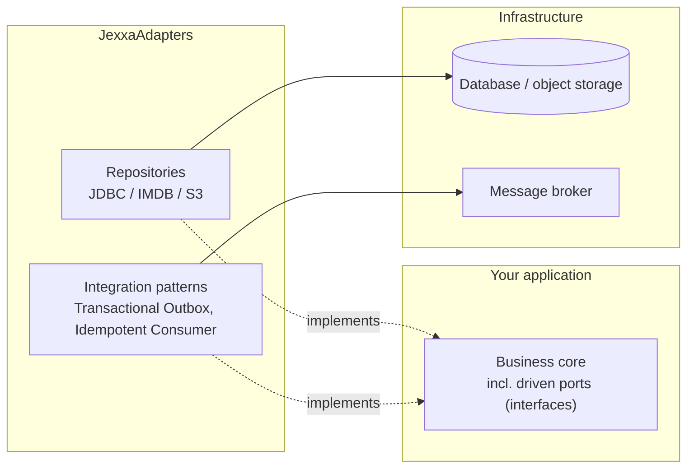

[](https://central.sonatype.com/artifact/io.jexxa.adapters/common-adapters)
[](https://opensource.org/licenses/Apache-2.0)
[](https://github.com/jexxa-projects/JexxaAdapters/actions/workflows/mavenBuild.yml)
[](https://github.com/jexxa-projects/JexxaAdapters/actions/workflows/codeql-analysis.yml)
[](https://www.bestpractices.dev/projects/12683)

# JexxaAdapters — Reusable Infrastructure for Ports & Adapters Applications

**JexxaAdapters** provides reusable Java infrastructure components for [Jexxa](https://github.com/jexxa-projects/Jexxa), [JLegMed](https://github.com/jexxa-projects/JLegMed), and other applications: infrastructure adapters, established integration patterns, and common utilities.

> Application-specific logic stays in your application. Technical details such as JDBC, JMS, or S3 stay in adapters that you do not have to write yourself.

The components support different architectural styles, from modular monoliths to microservices.

**Quick links:** [Quickstart](#quickstart) · [Capabilities](#capabilities) · [Ecosystem](#the-jexxa-projects-ecosystem)

## When to Use JexxaAdapters

Use JexxaAdapters if you

- build applications with [Jexxa](https://github.com/jexxa-projects/Jexxa) or [JLegMed](https://github.com/jexxa-projects/JLegMed) and need production-ready infrastructure for them,
- want to switch between JDBC, in-memory, and S3 persistence without changing application code, or
- need proven messaging patterns such as the transactional outbox or an idempotent consumer.


## Quickstart

**Requirements:** Java 25 or higher, and Maven or Gradle.

### Add the dependency

Maven:

```xml
<dependency>
    <groupId>io.jexxa.adapters</groupId>
    <artifactId>common-adapters</artifactId>
    <version>4.1.10</version> <!-- latest version: see Maven Central badge above -->
</dependency>
```

Gradle (Groovy DSL):

```groovy
dependencies {
    implementation 'io.jexxa.adapters:common-adapters:4.1.10'
}
```

### Examples

- [Driving adapter tests](common-adapters/src/test/java/io/jexxa/common/drivingadapter)
- [JexxaTutorials](https://github.com/jexxa-projects/JexxaTutorials): complete applications using these adapters
- [JLegMed](https://github.com/jexxa-projects/JLegMed): reusable processing components and integrations

## Modules

| Module            | Purpose                                                                                             |
|-------------------|-----------------------------------------------------------------------------------------------------|
| `adapter-api`     | Shared API used by the adapter libraries                                                            |
| `common-adapters` | Reusable adapters, integration patterns, facades, health checks, and in-process messaging utilities |


### Where it fits



All arrows show source-code dependencies: the adapters depend on the ports of your business core, never the other way round.

## Capabilities

### Infrastructure Adapters

Reusable adapters connect applications to infrastructure technologies without coupling application logic to their technical details.

- **Repositories:** implementations for JDBC, in-memory databases (IMDB), and S3, following the [Repository pattern](https://martinfowler.com/eaaCatalog/repository.html)


### Integration Patterns

- **Transactional Outbox:** coordinates database updates with eventual message publication without distributed transactions. See the [Transactional Outbox pattern](https://microservices.io/patterns/data/transactional-outbox.html).
- **Idempotent Consumer:** helps applications handle duplicate message deliveries. See the [Idempotent Consumer pattern](https://microservices.io/patterns/communication-style/idempotent-consumer.html).


### Common Utilities

- **Technology facades:** wrappers around JDBC, JMS, S3, JSON, and logging APIs that simplify adapter implementations
- **Health checks:** components for reporting application and infrastructure health
- **In-process publish/subscribe (`InProcessPubSub`):** lightweight, synchronous, type-based messaging within a single JVM process. It provides no persistence, asynchronous delivery, or retries.

## The Jexxa Projects Ecosystem

JexxaAdapters is part of **Jexxa Projects**: building blocks for durable business systems, consisting of modern, domain-driven applications and the bridges that connect them to legacy systems. Legacy systems stay as they are; the components that integrate them are built on a modern language level.

| Project                                                          | Role                                                           | Status                                   |
|------------------------------------------------------------------|----------------------------------------------------------------|------------------------------------------|
| [Jexxa](https://github.com/jexxa-projects/Jexxa)                 | Framework for DDD and Ports & Adapters applications (Java)     | In production for 6 years                |
| [JLegMed](https://github.com/jexxa-projects/JLegMed)             | Semantic bridging of legacy and modern systems (Java)          | In production for 1 year                 |
| [DigiSpine](https://github.com/jexxa-projects/DigiSpine)         | Digital backbone connecting business domains via domain events | In production for 1 year                 |
| CLegMed                                                          | C++23 counterpart to JLegMed                                   | In development                           |
| [JexxaAdapters](https://github.com/jexxa-projects/JexxaAdapters) | Reusable infrastructure adapters and integration patterns      | Supporting library for Jexxa and JLegMed |
| [Addend](https://github.com/jexxa-projects/Addend)               | Domain annotations for DDD                                     | Supporting library                       |

See the [Jexxa Projects overview](https://github.com/jexxa-projects) for all repositories.

## Requirements and Compatibility

- Java **25 or higher**
- Maven or Gradle

### Why Java 25?

Java 25 is not technically essential for JexxaAdapters. Requiring a current LTS release is a deliberate decision: the Jexxa Projects ecosystem is designed to connect legacy and modern systems, and any component that integrates legacy systems should itself be built on a modern language level. This keeps integration code maintainable and encourages updating legacy landscapes instead of conserving them.
 

## Build from Source

Clone the repository and build it with Maven:

```shell
mvn clean install
```

Some integration tests require the services defined in the [developer stack](deploy/developerStack.yml), including PostgreSQL and an ActiveMQ broker. Start them before running those tests:

```shell
docker compose -f deploy/developerStack.yml up -d
```


## Contributing

Contributions and pull requests are welcome. For substantial changes, please open an issue first to discuss the proposed approach. Include or update tests when changing behavior.


## FLOSS Commitment

This project is built and maintained using **Free/Libre Open Source Software (FLOSS)**. The build process (Maven), software bill of materials generation (CycloneDX), and signing (GPG) use open-source tooling.

## Copyright and License

- Code: [Apache License 2.0](LICENSE) ([plain-language overview](https://www.tldrlegal.com/license/apache-license-2-0-apache-2-0))
- Documentation: [Creative Commons Attribution 4.0 International](https://creativecommons.org/licenses/by/4.0/)
- © 2023–2026 Michael Repplinger